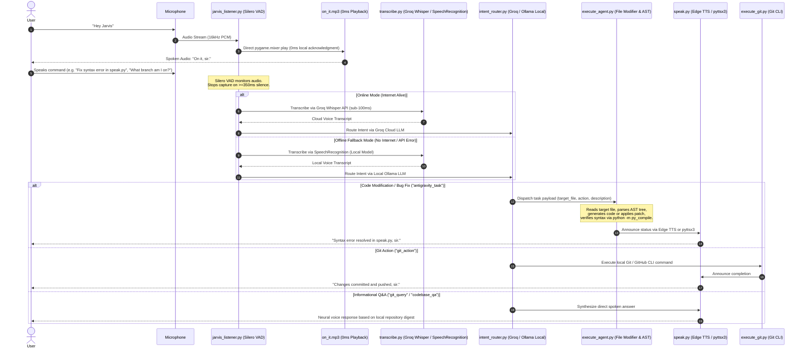

# Jarvis - Real-Time Codebase Assistant & Autonomous Voice Engineer

Zero-cost, dual-mode (Cloud + 100% Offline) voice assistant and autonomous coding engineer for **Codebase Q&A, File Inspection & Code Modifications, and Git/GitHub Automation**.

Jarvis operates with **zero latency** using **openWakeWord** (Sensitivity: 0.20), **0ms Local Wake Acknowledgment**, **Silero VAD** (350ms silence cutoff), and dynamically switches between ultra-fast cloud services (**Groq Whisper + Groq LLM**) and a **100% Local Offline Stack** (**SpeechRecognition + Local Ollama + pyttsx3**) when disconnected.

---

## Online vs. 100% Offline Capability Matrix

Jarvis features automatic, sub-5ms network connectivity detection (`is_online()`). If internet is unavailable or cloud APIs are unreachable, the entire pipeline seamlessly falls back to local on-device models with zero downtime:

| Capability | Online Mode (Default) | Offline Fallback Mode (100% Local) |
| :--- | :--- | :--- |
| **Wake Word Detection** | openWakeWord (`Hey Jarvis`) | openWakeWord (`Hey Jarvis`, 100% Local CPU) |
| **Wake Acknowledgment** | Pre-rendered `on_it.mp3` (0ms delay) | Pre-rendered `on_it.mp3` (0ms delay) |
| **Speech-to-Text (ASR)** | Groq Cloud Whisper (`whisper-large-v3-turbo`) | Local `SpeechRecognition` (`tiny` model on CPU) |
| **LLM Reasoning & Routing** | Groq API (`llama-3.3-70b-versatile` / `qwen`) | Local **Ollama** (`llama3:latest` / `qwen3:1.7b`) |
| **Codebase Context Digest** | 120s TTL In-Memory File Scanner | 120s TTL In-Memory File Scanner |
| **File Reading & Code Mod** | Full local workspace read/write & AST check | **Full local workspace read/write & AST check** |
| **Autonomous Code Bridge** | Antigravity IDE Agent Bridge (Ctrl+L / Ctrl+V) | Antigravity IDE Agent Bridge & Local Code Gen |
| **Voice Synthesis (TTS)** | Microsoft Edge Neural (`ChristopherNeural`) | Local Windows SAPI5 (`pyttsx3`) |
| **Git / GitHub Automation** | Local Git CLI + GitHub CLI (`gh`) | Local Git CLI (`git commit`, `branch`, `revert`) |

---

## Dual-Mode Voice & Automation Architecture



---

## Local Ollama LLM & Offline File Manipulation Engine

Jarvis can operate as a **fully self-contained, air-gapped developer assistant** without sending any proprietary code or voice data outside your local machine.

### 1. Local Ollama Integration (`intent_router.py`)
- **Automatic Model Discovery**: Automatically inspects installed Ollama models via `http://localhost:11434/api/tags` and selects the best installed model (e.g., `llama3:latest`, `qwen3:1.7b`, `qwen3:4b`, `qwen3.5:latest`).
- **Configurable in `.env`**: You can explicitly pin your preferred offline model using `OLLAMA_MODEL=llama3:latest`.
- **Hardware-Optimized Prompting**: Employs a compact, high-efficiency system prompt with strict token limits (`num_predict: 120`) to guarantee fast, sub-few-second inference even when running purely on CPU.
- **Robust JSON Sanitization**: Extracts valid structured actions (`type`, `command`, `speaking_start`, `speaking_response`) even from reasoning models with thinking tokens.

### 2. Workspace File Access & In-Memory Digest
- **Instant Codebase Indexer**: `get_project_context()` crawls key source files (`.py`, `.js`, `.ts`, `.json`, `.md`) up to 12 candidate files with a 120-second TTL cache.
- **Context Injection**: Injects active Git branch, target repository name, and code digest directly into the prompt so the local LLM knows the exact state of your workspace.

### 3. Autonomous Local File Modification (`execute_agent.py`)
When you request a code modification, bug fix, or new script (e.g. *"Fix the error in test.py"* or *"Create a new utility module for database backups"*):
- **AST Parsing & Inspection**: Uses Python's native `ast.parse` module to analyze root nodes, inspect functions, and pinpoint exact syntax defects and line numbers.
- **Automated Code Generation & Scaffolding**: If a target file does not exist, Jarvis synthesizes a clean, production-ready module scaffold with docstrings, entrypoints, and standard logging.
- **Pre-Commit Syntax Verification**: Automatically runs:
  ```powershell
  python -m py_compile <target_file>
  ```
  This guarantees that code changes are 100% syntactically sound before notifying the developer or committing changes.
- **Antigravity IDE Bridge (`antigravity_bridge.py`)**: For complex multi-file engineering tasks, Jarvis automatically brings Antigravity IDE to the foreground, opens the agent panel (`Ctrl+L`), pastes the task prompt (`Ctrl+V`), and submits it (`Enter`).

---

## Detailed Component Breakdown

### 1. Voice Listener (`jarvis_listener.py`)
- **openWakeWord Engine**: Continuously streams 16kHz microphone audio at 80ms chunk intervals.
- **Instant Local Acknowledgment**: Fires `on_it.mp3` directly via `pygame.mixer` the instant wake word is detected (0ms delay).
- **Rolling Audio Buffer**: 640ms pre-roll rolling buffer preserves initial syllables so soft phrases (e.g., *"Can you..."*) are never clipped.
- **Silero VAD**: Cuts off recording 350ms after speech ends for rapid command dispatch.

### 2. Speech-to-Text (`transcribe.py`)
- **Primary (Online)**: Groq Cloud Whisper (`whisper-large-v3-turbo`) with custom developer vocabulary prompt.
- **Fallback (Offline)**: Python `SpeechRecognition` library (`r.recognize_whisper(audio, model="tiny")`), processing audio completely on-device.

### 3. Intent Router (`intent_router.py`)
- **Primary (Online)**: Groq Cloud API (`llama-3.3-70b-versatile`, `qwen-2.5-32b`).
- **Fallback (Offline)**: Local Ollama model running on `localhost:11434`.
- **Zero-Latency Deterministic Routing**: Instant regex matching for emergency stops, branch deletions, reverts, and Git queries runs in `< 1ms`.

### 4. Speech Synthesis (`speak.py`)
- **Primary (Online)**: Microsoft Edge Neural TTS with high-definition `en-US-ChristopherNeural` voice.
- **Fallback (Offline)**: Local Windows SAPI5 (`pyttsx3`) voice synthesizer.
- **Instant Interruptibility**: Sets `jarvis_stop.flag` to terminate running TTS processes immediately when user says *"Jarvis, stop"*.

---

## Configuration (`.env`)

Create or update your `.env` file in the project root:

```ini
# Groq Cloud API Key (for ultra-fast online transcription & LLM)
GROQ_API_KEY=gsk_your_groq_api_key_here

# Local Ollama Configuration (for 100% offline fallback)
OLLAMA_HOST=http://localhost:11434
OLLAMA_MODEL=llama3:latest

# Target Repository Path (. for current repository)
TARGET_REPO_PATH=.

# Optional n8n Webhook Integration
N8N_WEBHOOK_URL=http://localhost:5678/webhook/jarvis-git
DISPATCH_TO_N8N=false
```

---

## Global CLI & Multi-Project Support

Jarvis can be initialized and run in **any project folder or workspace** inside Antigravity IDE:

```powershell
# Initialize Jarvis in the current folder (or pass a target directory):
# - Verifies/initializes Git repository
# - Scaffolds .jarvis/config.json and local batch shortcuts
# - Verifies background n8n server (starts it automatically if stopped)
# - Opens the Cybernetic Sci-Fi HUD desktop window for that project
jarvis init [project_path]

# Start both HUD and Voice Listener for the active project
jarvis start [project_path]

# Open just the Cybernetic Sci-Fi HUD window
jarvis hud [project_path]

# Check background n8n automation status
jarvis n8n

# Check current active project, Git branch, and pipeline telemetry
jarvis status
```

### Running Locally inside Core Repository

```powershell
# 1. Start n8n Workflow Server in background (optional)
.\start_n8n.bat

# 2. Launch Cybernetic HUD Window
.\start_hud.bat

# 3. Start Zero-Latency Voice Listener
.\start_jarvis.bat
```
